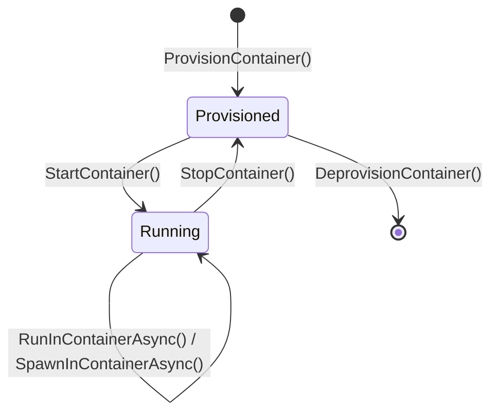

# Chapter 2: The .NET C# SDK Deep Dive (`Microsoft.Mxc.Sdk.V1`)

> **Target Audience:** C# / .NET Developers, Tool Authors  
> **Prerequisites:** Chapter 1, Async/Await in .NET, Stream Processing

---

## 2.1 Project Setup and Nuget Packaging

The official .NET SDK for MXC is located under `Microsoft.Mxc.Sdk.V1`. It is compiled against modern .NET 8 / 9 / 10 and supports cross-platform execution on Windows (x64, ARM64), Linux (x64, ARM64), and macOS (ARM64).

### Project Configuration (`.csproj`)
```xml
<Project Sdk="Microsoft.NET.Sdk">
  <PropertyGroup>
    <OutputType>Exe</OutputType>
    <TargetFramework>net9.0</TargetFramework>
    <ImplicitUsings>enable</ImplicitUsings>
    <Nullable>enable</Nullable>
    <!-- Enable Native AOT support if building high-performance microservices -->
    <PublishAot>false</PublishAot>
  </PropertyGroup>

  <ItemGroup>
    <PackageReference Include="Microsoft.Mxc.Sdk" Version="1.0.0" />
  </ItemGroup>
</Project>
```

---

## 2.2 Host Diagnostics & Platform Discovery (`MxcPlatform`)

Before issuing sandbox requests in production, robust agent applications must discover host capabilities and verify containment availability.

```csharp
using Microsoft.Mxc.Sdk;
using Microsoft.Mxc.Sdk.V1;

// 1. Basic Support Check
PlatformSupport support = MxcPlatform.GetPlatformSupport();
if (!support.IsSupported)
{
    Console.Error.WriteLine($"MXC cannot run on this host: {support.Reason}");
    return;
}

Console.WriteLine($"Primary Host Backend: {support.Backend}");

// 2. Discover All Available Backends & Probed Capabilities
IReadOnlyList<AvailableBackend> backends = MxcPlatform.GetAvailableBackends();
foreach (var b in backends)
{
    Console.WriteLine($"Backend: {b.Backend}, Tier: {b.Tier}");
    Console.WriteLine($"Capabilities: {string.Join(", ", b.Capabilities)}");
    foreach (var warning in b.Warnings)
    {
        Console.WriteLine($"  [Warning]: {warning}");
    }
}
```

---

## 2.3 Transient Execution (`MxcContainer`)

`MxcContainer` is the static entrypoint for running self-contained, one-shot workloads. When the workload finishes (or times out), the sandbox and its ephemeral filesystem are instantly destroyed.

### 1. Synchronous vs. Asynchronous Captured Execution (`Run` / `RunAsync`)

`RunAsync` executes the command to completion, buffers standard output and standard error, and returns an immutable `ExecutionResult`.

```csharp
var request = new ContainerRequest("python -c \"print('Hello from sandboxed Python!')\"")
{
    TimeoutMs = 10_000,
    WorkingDirectory = "/tmp/sandbox",
    Filesystem = new FilesystemPolicy
    {
        ReadonlyPaths = { "/usr/lib/python3.11", "/usr/bin/python3" },
        ReadwritePaths = { "/tmp/sandbox" }
    }
};

try
{
    ExecutionResult result = await MxcContainer.RunAsync(request);

    Console.WriteLine($"Exit Code: {result.ExitCode}");
    Console.WriteLine($"Timed Out: {result.TimedOut}");
    Console.WriteLine($"Stdout:\n{result.Stdout}");

    if (!string.IsNullOrEmpty(result.Stderr))
    {
        Console.Error.WriteLine($"Stderr:\n{result.Stderr}");
    }

    foreach (var warning in result.Warnings)
    {
        Console.WriteLine($"Sandbox Warning: {warning}");
    }
}
catch (MxcException ex)
{
    Console.Error.WriteLine($"MXC Execution Failed [{ex.Code}]: {ex.Message}");
}
```

> **Important Note on Cancellation Tokens:** Passing a `CancellationToken` to `RunAsync` cancels .NET's awaiter on the task, but native execution is bounded by `ContainerRequest.TimeoutMs`. Always set a realistic `TimeoutMs` to prevent orphaned background processes.

---

### 2. Live Pipe Streaming (`Spawn` / `SpawnAsync`)

For long-running tasks, live console feedback to users, or streaming output tokens to an AI Agent, use `SpawnAsync`. It returns an `MxcProcess` exposing live standard streams (`StandardInput`, `StandardOutput`, `StandardError`).

```csharp
var request = new ContainerRequest("dotnet run --project /workspace/App.csproj")
{
    TimeoutMs = 60_000,
    WorkingDirectory = "/workspace",
    Filesystem = new FilesystemPolicy
    {
        ReadwritePaths = { "/workspace", "/tmp" }
    }
};

using MxcProcess process = await MxcContainer.SpawnAsync(request);

// Asynchronously stream stdout and stderr line-by-line
var stdoutTask = Task.Run(async () =>
{
    using var reader = new StreamReader(process.StandardOutput!);
    while (await reader.ReadLineAsync() is { } line)
    {
        Console.WriteLine($"[AGENT STDOUT] {line}");
    }
});

var stderrTask = Task.Run(async () =>
{
    using var reader = new StreamReader(process.StandardError!);
    while (await reader.ReadLineAsync() is { } line)
    {
        Console.Error.WriteLine($"[AGENT STDERR] {line}");
    }
});

// Wait for child process exit
WaitResult waitResult = await process.WaitAsync();
await Task.WhenAll(stdoutTask, stderrTask);

Console.WriteLine($"Process exited with code {waitResult.ExitCode} (TimedOut: {waitResult.TimedOut})");
```

---

### 3. Interactive Terminals (`SpawnWithPty`)

Interactive command-line applications (such as `bash`, `powershell`, `vim`, or progress-bar CLI tools) require a Pseudoterminal (PTY).

```csharp
var ptyOptions = new PtyOptions
{
    Columns = 120,
    Rows = 30
};

using MxcPtyProcess ptyProcess = MxcContainer.SpawnWithPty(
    new ContainerRequest("bash -i")
    {
        WorkingDirectory = "/tmp"
    }, 
    ptyOptions);

// Write commands directly into PTY master
using var writer = new StreamWriter(ptyProcess.StandardInput) { AutoFlush = true };
await writer.WriteLineAsync("ls -la");
await writer.WriteLineAsync("exit");

// Dynamically resize terminal window when the host UI changes
await ptyProcess.ResizeAsync(new TerminalSize { Columns = 140, Rows = 40 });

WaitResult exit = await ptyProcess.WaitAsync();
Console.WriteLine($"PTY Session closed with exit code: {exit.ExitCode}");
```

---

## 2.4 State-Aware Container Lifecycle (`MxcLifecycle`)

When an agent needs to perform a **multi-step workflow** (e.g., Turn 1: initialize a git repo; Turn 2: write source files; Turn 3: install dependencies; Turn 4: compile and test), transient sandboxes are inefficient because state is lost between executions.

`MxcLifecycle` manages persistent containers across five deterministic phases:



### Complete Lifecycle Code Example

```csharp
using Microsoft.Mxc.Sdk;
using Microsoft.Mxc.Sdk.V1;

ContainerId? containerId = null;
bool isStarted = false;

try
{
    // Step 1: Provision
    var provisionRequest = new IsolationSessionProvisionRequest(new NetworkPolicy
    {
        Egress = new NetworkEgressPolicy { Default = NetworkAction.Allow },
        Ingress = new NetworkIngressPolicy { Default = NetworkAction.Deny }
    });

    ProvisionResult provisionResult = MxcLifecycle.ProvisionContainer(provisionRequest);
    containerId = provisionResult.ContainerId;
    Console.WriteLine($"Container Provisioned. ID: {containerId}");

    // Step 2: Start
    MxcLifecycle.StartContainer(containerId.Value);
    isStarted = true;
    Console.WriteLine("Container Started.");

    // Step 3: Execute Step 1 (Create directory and write file)
    var exec1 = new ExecutionRequest("cmd.exe /c \"mkdir C:\\workspace && echo DataAnalysis=Ready > C:\\workspace\\state.txt\"");
    var res1 = await MxcLifecycle.RunInContainerAsync(containerId.Value, exec1);
    Console.WriteLine($"Step 1 exit code: {res1.ExitCode}");

    // Step 4: Execute Step 2 (Read back file created in Step 1)
    var exec2 = new ExecutionRequest("cmd.exe /c \"type C:\\workspace\\state.txt\"");
    var res2 = await MxcLifecycle.RunInContainerAsync(containerId.Value, exec2);
    Console.WriteLine($"Step 2 Output: {res2.Stdout.Trim()}"); // Output: DataAnalysis=Ready
}
finally
{
    // Step 5: Graceful Cleanup
    if (containerId is { } id)
    {
        if (isStarted)
        {
            try { MxcLifecycle.StopContainer(id); }
            catch (MxcException ex) { Console.Error.WriteLine($"Stop error: {ex.Message}"); }
        }

        try { MxcLifecycle.DeprovisionContainer(id); }
        catch (MxcException ex) { Console.Error.WriteLine($"Deprovision error: {ex.Message}"); }
    }
}
```

---

## 2.5 Security Policy Configuration in Depth

### 1. Filesystem Policies & Built-in Discoverers
MXC provides discovery helpers in `Microsoft.Mxc.Sdk.V1.Policy.Filesystem` to safely discover host tools and paths without hardcoding system locations:

```csharp
using Microsoft.Mxc.Sdk.V1.Policy;

// Automatically discover installed SDKs and standard tool paths
FilesystemPolicyResult tools = Filesystem.GetAvailableToolsPolicy();
FilesystemPolicyResult userDirs = Filesystem.GetUserProfilePolicy();
FilesystemPolicyResult tempDir = Filesystem.GetTemporaryFilesPolicy();

var policy = new FilesystemPolicy();

// Merge read-only tool access
foreach (var p in tools.ReadonlyPaths) policy.ReadonlyPaths.Add(p);
foreach (var p in userDirs.ReadonlyPaths) policy.ReadonlyPaths.Add(p);

// Grant workspace read-write
policy.ReadwritePaths.Add("/app/workspace");

// Deny specific secret subdirectories or credential files
policy.DeniedPaths.Add("/app/workspace/.env");
policy.DeniedPaths.Add("/app/workspace/secrets.json");
```

### 2. Directional Network Policies & Proxy Mediation
```csharp
var network = new NetworkPolicy
{
    Egress = new NetworkEgressPolicy
    {
        Default = NetworkAction.Deny,
        Allow =
        {
            // Allow HTTPS traffic only to PyPI repository CIDR block
            new EgressRule
            {
                To = { new NetworkTarget { Cidr = "151.101.0.0/16" } },
                Ports = { new NetworkPort { Port = 443, Protocol = NetworkProtocol.Tcp } }
            }
        }
    },
    Ingress = new NetworkIngressPolicy
    {
        Default = NetworkAction.Deny,
        HostLoopback = NetworkAction.Deny // Block container from querying host services (e.g. 127.0.0.1:5000)
    }
};
```

---

## 2.6 Robust Error Handling with `MxcException`

The .NET SDK maps all native engine errors to strongly-typed `MxcException` instances with specific `ErrorCode` enums:

```csharp
try
{
    var result = await MxcContainer.RunAsync(request);
}
catch (MxcException ex)
{
    switch (ex.Code)
    {
        case ErrorCode.PolicyViolation:
            Console.Error.WriteLine($"Action blocked by security policy: {ex.Message}");
            break;

        case ErrorCode.UnsupportedContainment:
            Console.Error.WriteLine($"Requested backend or isolation feature is not available on this OS: {ex.Message}");
            break;

        case ErrorCode.Timeout:
            Console.Error.WriteLine($"Process execution exceeded deadline: {ex.Message}");
            break;

        case ErrorCode.InvalidInput:
            Console.Error.WriteLine($"Malformed request parameters: {ex.Message}");
            break;

        case ErrorCode.BackendError:
        default:
            Console.Error.WriteLine($"Internal backend failure [{ex.Code}]: {ex.Message}");
            break;
    }
}
```

---

## 2.7 Native AOT & Performance Architecture

In high-scale enterprise AI agent gateways, container invocation overhead must be minimal. The .NET SDK is fully trimmed and Native AOT compatible:
- Serializes/deserializes all wire contracts using `System.Text.Json` source generators (`MxcJsonContext`).
- Avoids runtime reflection, dynamic code generation, or heavy unmanaged wrappers.
- Employs `SafeHandle` derivatives (`SafeMxcProcessHandle`, `SafeMxcPtyProcessHandle`) for zero handle leakage and deterministic GC finalization.

In **Chapter 3**, we will integrate `Microsoft.Mxc.Sdk` into the **Microsoft Agent Framework (MAF)** to build production-grade AI Agent tools and autonomous coding assistants.
