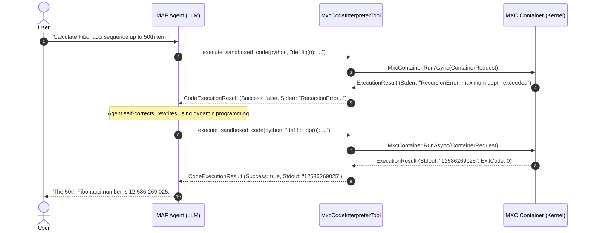

# Chapter 3: Microsoft Agent Framework (MAF) Integration in C#

> **Target Audience:** AI Engineers, Agent Developers, Software Architects  
> **Prerequisites:** Chapters 1 & 2, `Microsoft.Agents.AI`, `Microsoft.Extensions.AI`

---

## 3.1 The Role of Sandboxing in Microsoft Agent Framework

The **Microsoft Agent Framework (MAF)** (`Microsoft.Agents.AI` and `Microsoft.Extensions.AI`) enables .NET developers to build autonomous, multi-agent systems, chat agents, and tool-augmented workflows. 

When an agent needs to perform:
- **Complex mathematical computations**
- **Data analysis, visualization, and table filtering**
- **Autonomous code generation, compilation, and testing**
- **File conversions (e.g., CSV to Parquet, PDF generation, image transformation)**

Instead of asking the LLM to hallucinate outputs, the agent generates code and executes it in an environment. Using **MXC** as the underlying execution engine guarantees that untrusted, model-generated code cannot compromise the host application, exfiltrate data, or corrupt the host filesystem.

```
+-----------------------------------------------------------------------------------+
|                        Microsoft Agent Framework (MAF)                            |
|                                                                                   |
|  +--------------------+   Prompt / Goal   +------------------------------------+  |
|  |     User Chat      | ----------------> |             AIAgent                |  |
|  |     Interface      |                   | (LLM: GPT-4o / Claude / DeepSeek)  |  |
|  +--------------------+                   +------------------------------------+  |
|            ^                                                 |                    |
|            | Stream Tokens / Result                          | Generates Code &   |
|            |                                                 | Calls Tool         |
|            |                                                 v                    |
|  +--------------------+                   +------------------------------------+  |
|  |  Agent Response    | <---------------- |       MxcCodeInterpreterTool       |  |
|  +--------------------+   Returns Stdout  |   [AIFunction / Tool Interface]    |  |
|                           & Artifacts     +------------------------------------+  |
+--------------------------------------------------------------|--------------------+
                                                               |
                                            Invokes C# SDK     | MxcContainer.RunAsync()
                                                               v
                                    +------------------------------------+
                                    |         Microsoft.Mxc.Sdk          |
                                    |  (Isolated Process / Container)    |
                                    +------------------------------------+
                                    |  - Filesystem: /tmp/workspace ONLY |
                                    |  - Network: Egress DENIED          |
                                    |  - Execution Time: 15s max         |
                                    +------------------------------------+
```

---

## 3.2 Designing the `MxcCodeInterpreterTool`

A production-grade code interpreter tool for MAF must:
1. Accept language, code content, and optional dependencies.
2. Prepare a clean, ephemeral sandbox directory.
3. Apply strict deny-by-default filesystem and network policies.
4. Execute via `MxcContainer.RunAsync` with bounded timeouts.
5. Return structured, LLM-digestible feedback (exit code, stdout, stderr, execution duration).

### Implementation of the Tool

```csharp
using System.ComponentModel;
using System.Diagnostics;
using System.Text;
using Microsoft.Extensions.AI;
using Microsoft.Mxc.Sdk;
using Microsoft.Mxc.Sdk.V1;

namespace MxcMafAgent.Tools;

/// <summary>
/// Result returned to the AI Agent describing code execution outcome.
/// </summary>
public record CodeExecutionResult(
    bool Success,
    int ExitCode,
    string Stdout,
    string Stderr,
    double ExecutionTimeMs,
    string? ErrorMessage = null);

/// <summary>
/// Production MAF Tool providing sandboxed code execution via MXC.
/// </summary>
public class MxcCodeInterpreterTool
{
    private readonly string _workspaceBase;

    public MxcCodeInterpreterTool(string? workspaceBase = null)
    {
        _workspaceBase = workspaceBase ?? Path.Combine(Path.GetTempPath(), "mxc_agent_sandboxes");
        Directory.CreateDirectory(_workspaceBase);
    }

    [Description("Executes code in an isolated, secure MXC container and returns stdout, stderr, and exit code.")]
    public async Task<CodeExecutionResult> ExecuteCodeAsync(
        [Description("Programming language to execute: 'python', 'csharp', 'javascript', 'bash', 'powershell'")] 
        string language,
        [Description("The source code to execute.")] 
        string code,
        [Description("Maximum execution timeout in milliseconds. Defaults to 20000 (20s).")] 
        int timeoutMs = 20_000,
        CancellationToken cancellationToken = default)
    {
        // 1. Create a dedicated ephemeral directory for this execution
        var sessionId = Guid.NewGuid().ToString("N");
        var sessionDir = Path.Combine(_workspaceBase, sessionId);
        Directory.CreateDirectory(sessionDir);

        var stopwatch = Stopwatch.StartNew();

        try
        {
            // 2. Prepare script file and command line based on language
            string scriptFileName;
            string commandLine;

            switch (language.ToLowerInvariant())
            {
                case "python":
                case "py":
                    scriptFileName = "script.py";
                    commandLine = OperatingSystem.IsWindows() 
                        ? $"python.exe \"{Path.Combine(sessionDir, scriptFileName)}\"" 
                        : $"python3 \"{Path.Combine(sessionDir, scriptFileName)}\"";
                    break;

                case "javascript":
                case "js":
                case "node":
                    scriptFileName = "index.js";
                    commandLine = $"node \"{Path.Combine(sessionDir, scriptFileName)}\"";
                    break;

                case "bash":
                case "sh":
                    scriptFileName = "script.sh";
                    commandLine = $"bash \"{Path.Combine(sessionDir, scriptFileName)}\"";
                    break;

                case "powershell":
                case "ps1":
                    scriptFileName = "script.ps1";
                    commandLine = $"powershell.exe -NoProfile -NonInteractive -ExecutionPolicy Bypass -File \"{Path.Combine(sessionDir, scriptFileName)}\"";
                    break;

                default:
                    return new CodeExecutionResult(
                        Success: false,
                        ExitCode: -1,
                        Stdout: string.Empty,
                        Stderr: string.Empty,
                        ExecutionTimeMs: 0,
                        ErrorMessage: $"Unsupported language '{language}'. Supported: python, javascript, bash, powershell.");
            }

            // Write the agent's code to the sandbox directory
            var scriptFilePath = Path.Combine(sessionDir, scriptFileName);
            await File.WriteAllTextAsync(scriptFilePath, code, Encoding.UTF8, cancellationToken);

            // 3. Configure strict MXC security policy
            var request = new ContainerRequest(commandLine)
            {
                Containment = new Containment.Process(),
                WorkingDirectory = sessionDir,
                TimeoutMs = (uint)timeoutMs,
                Filesystem = new FilesystemPolicy
                {
                    // Sandbox can ONLY read and write within its own session directory
                    ReadwritePaths = { sessionDir }
                },
                Network = new NetworkPolicy
                {
                    // Block all network ingress and egress by default
                    Egress = new NetworkEgressPolicy { Default = NetworkAction.Deny },
                    Ingress = new NetworkIngressPolicy 
                    { 
                        Default = NetworkAction.Deny, 
                        HostLoopback = NetworkAction.Deny 
                    }
                },
                Environment = new Dictionary<string, string>
                {
                    ["PYTHONUNBUFFERED"] = "1",
                    ["NODE_ENV"] = "production"
                },
                InheritDefaultEnvironment = true
            };

            // 4. Run inside the container
            ExecutionResult result = await MxcContainer.RunAsync(request, cancellationToken: cancellationToken);
            stopwatch.Stop();

            if (result.TimedOut)
            {
                return new CodeExecutionResult(
                    Success: false,
                    ExitCode: 124,
                    Stdout: result.Stdout,
                    Stderr: result.Stderr + "\n[ERROR]: Code execution timed out.",
                    ExecutionTimeMs: stopwatch.Elapsed.TotalMilliseconds,
                    ErrorMessage: "Execution timed out.");
            }

            return new CodeExecutionResult(
                Success: result.ExitCode == 0,
                ExitCode: result.ExitCode,
                Stdout: result.Stdout,
                Stderr: result.Stderr,
                ExecutionTimeMs: stopwatch.Elapsed.TotalMilliseconds);
        }
        catch (MxcException ex)
        {
            stopwatch.Stop();
            return new CodeExecutionResult(
                Success: false,
                ExitCode: (int)ex.Code,
                Stdout: string.Empty,
                Stderr: $"MXC Security Containment Error: {ex.Message}",
                ExecutionTimeMs: stopwatch.Elapsed.TotalMilliseconds,
                ErrorMessage: ex.Message);
        }
        finally
        {
            // Cleanup session directory
            try
            {
                if (Directory.Exists(sessionDir))
                {
                    Directory.Delete(sessionDir, recursive: true);
                }
            }
            catch
            {
                // Background cleanup or ephemeral disk mount handles leftover temp files
            }
        }
    }
}
```

---

## 3.3 Registering the Tool with Microsoft Agent Framework

Using `Microsoft.Extensions.AI` and MAF's `ChatClientAgent`, we register `MxcCodeInterpreterTool` as an `AIFunction`:

```csharp
using Microsoft.Agents.AI;
using Microsoft.Extensions.AI;
using MxcMafAgent.Tools;

// 1. Initialize your LLM ChatClient (OmniRoute Gateway, Azure OpenAI, vLLM, etc.)
EnvLoader.Load(); // Automatically loads from .env or C:\Repo\samples\jev\.env

string omniRouterBaseUrl = Environment.GetEnvironmentVariable("OMNIROUTER_BASE_URL") ?? "http://localhost:20128/v1";
string omniRouterApiKey  = Environment.GetEnvironmentVariable("OMNIROUTER_API_KEY")  ?? "sk-your-omnirouter-api-key-here";
string modelId           = Environment.GetEnvironmentVariable("SPECIALIST_MODEL")   ?? "l-s-Poc/gemini-3.7-flash";

IChatClient chatClient = new OpenAiCompatibleChatClient(
    omniRouterBaseUrl,
    omniRouterApiKey,
    modelId);

// 2. Instantiate MXC Tool
var mxcTool = new MxcCodeInterpreterTool();

// 3. Create MAF AIFunction wrapper
AITool codeInterpreterFunction = AIFunctionFactory.Create(
    mxcTool.ExecuteCodeAsync,
    name: "execute_sandboxed_code",
    description: "Executes Python, JS, or Bash code in a secure sandboxed container. Use this for math, data analysis, and script verification.");

// 4. Build the MAF Agent
var agent = new DataScienceAgent(chatClient, mxcTool);
string result = await agent.RunAnalysisAsync("Calculate prime factors of 982451653");

---

## 3.4 Multi-Turn Conversational Execution and Self-Correction

When an agent executes code that fails (e.g. `SyntaxError`, `ZeroDivisionError`, `ModuleNotFoundError`), the MAF execution loop automatically supplies the stderr result back to the model.



---

## 3.5 Stateful Agent Workflows with `MxcLifecycle`

For advanced agents (such as autonomous software developers or data science pipelines) that perform a series of dependent operations over several minutes, we create a **Stateful Sandbox Session**:

```csharp
using Microsoft.Mxc.Sdk;
using Microsoft.Mxc.Sdk.V1;

public sealed class StatefulAgentWorkspace : IAsyncDisposable
{
    private readonly ContainerId _containerId;
    private bool _isStarted;

    private StatefulAgentWorkspace(ContainerId containerId)
    {
        _containerId = containerId;
    }

    public static async Task<StatefulAgentWorkspace> CreateAsync()
    {
        var provisionRequest = new IsolationSessionProvisionRequest(new NetworkPolicy
        {
            Egress = new NetworkEgressPolicy { Default = NetworkAction.Allow },
            Ingress = new NetworkIngressPolicy { Default = NetworkAction.Deny }
        });

        var provisionResult = MxcLifecycle.ProvisionContainer(provisionRequest);
        MxcLifecycle.StartContainer(provisionResult.ContainerId);

        return new StatefulAgentWorkspace(provisionResult.ContainerId) { _isStarted = true };
    }

    public async Task<ExecutionResult> RunCommandAsync(string command, uint timeoutMs = 30_000)
    {
        var execRequest = new ExecutionRequest(command)
        {
            TimeoutMs = timeoutMs
        };

        return await MxcLifecycle.RunInContainerAsync(_containerId, execRequest);
    }

    public async ValueTask DisposeAsync()
    {
        if (_isStarted)
        {
            try { MxcLifecycle.StopContainer(_containerId); } catch { }
        }
        try { MxcLifecycle.DeprovisionContainer(_containerId); } catch { }
    }
}
```

In **Chapter 4**, we will explore deployment requirements across diverse environments, including **Docker containers, Kubernetes clusters, and Linux servers**.
